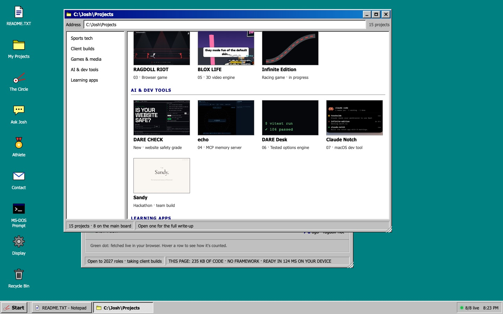
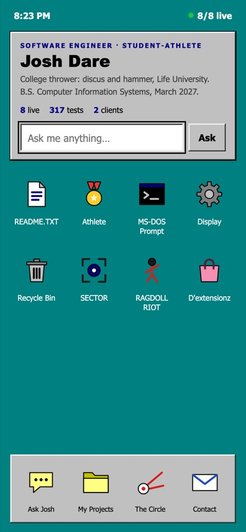
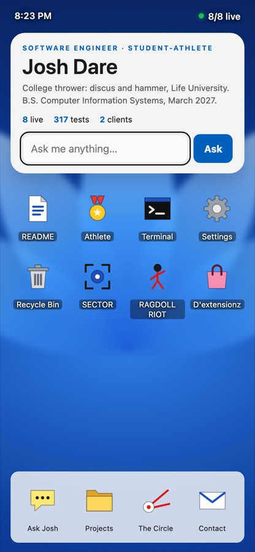
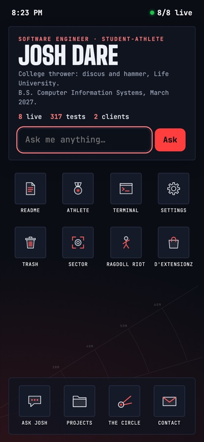
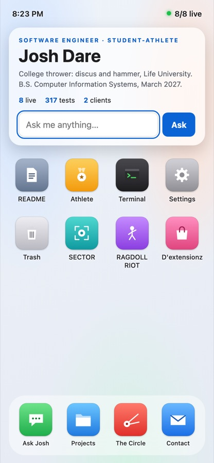
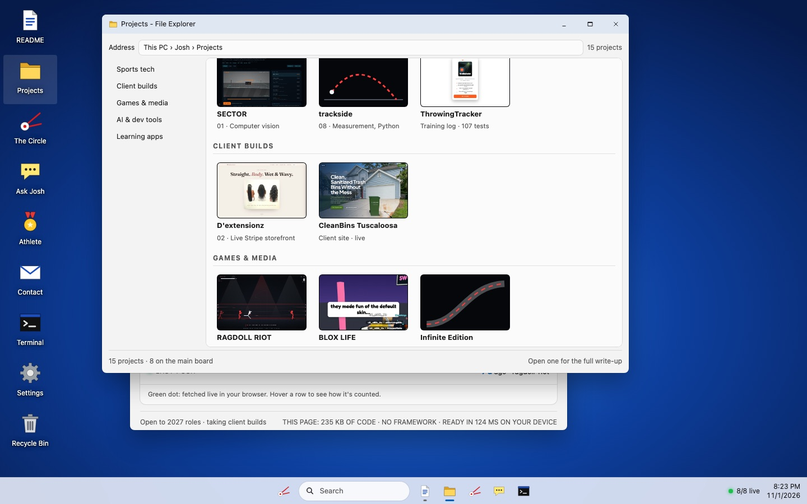
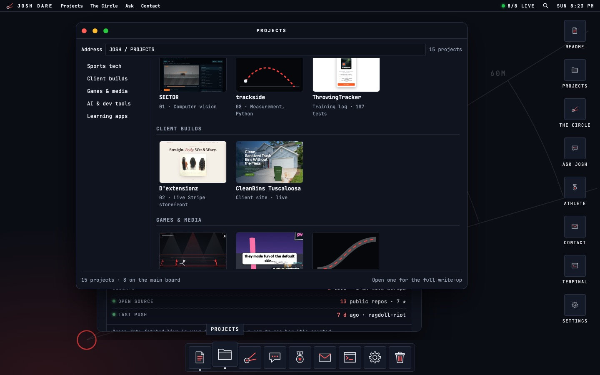
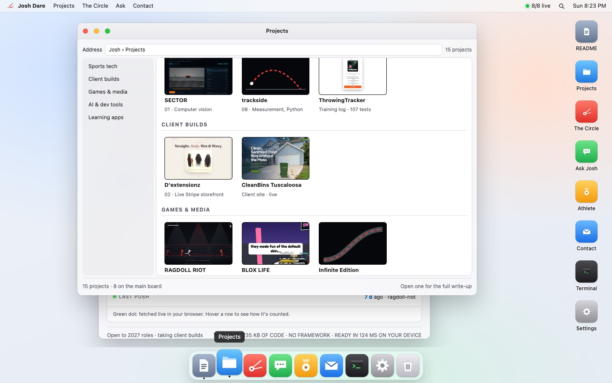

  

<h1 align="center">DARE-OS</h1>

  The portfolio of <b>Joshua Dare</b>: software engineer and college thrower (discus, hammer). 
  Built as a desktop you can actually use.

  <a href="https://dare-os.vercel.app"><b>dare-os.vercel.app</b></a>

  

## What's inside

- **Four themes.** Retro 98 (default), Windows 11, Mac Light and Throws Night, each with its own window chrome, Start menu and icon names. Shareable with `?theme=`.
- **15 projects** in a file explorer, grouped into sports tech, client builds, games and media, AI and dev tools, and learning apps. Each one opens a full write-up.
- **Ask Josh.** A chat that answers questions about my work from a fact file, with no AI model and no API calls. It follows up on the last project you asked about and says so when something isn't in the file.
- **The Circle.** A discus throw game on canvas: hold to spin, release in the window. Speed, angle and height set the mark.
- **MS-DOS Prompt / Terminal**, a Recycle Bin, live status checks on every shipped project, and deep links to any window.
- **Phone layout.** A home screen with a dock, built for one-handed use.

  
  
  
  

## Featured work

| Project | What it is |
|---|---|
| **SECTOR** | Measures a throw (release speed, angle, height) from a single phone video |
| **ThrowingTracker** | Training log and analytics for throwers, offline-first |
| **GlobalLingo** | Translation app with a Three.js globe (click a country to pick its language) and haptics on mobile |
| **echo** | MCP memory server with a 3D brain view (React Three Fiber) |
| **RAGDOLL RIOT** | Browser brawler with ragdoll physics |
| **BLOX LIFE** | 3D video engine (Three.js, Web Audio, FFmpeg) that renders short skits |
| **Infinite Edition** | Arcade racing game with drift physics in Three.js (private, in progress) |
| **Claude Notch** | Native macOS app that puts coding sessions in the notch |
| **DARE CHECK** | Free website safety grade |
| **Client sites** | D'extensionz (live store) and CleanBins Tuscaloosa |

## Built with

Plain HTML, CSS and JavaScript. No framework and no build step. The whole page is about 235 KB of code.

Tested with Node and Playwright: 178 chat checks and 65 page checks (layout, themes, keyboard, phone, no-JS fallback, zero console errors).

## Contact

[LinkedIn](https://www.linkedin.com/in/akinwaledare) · [GitHub](https://github.com/Waleee7) · jdare354@gmail.com

More screenshots

 

