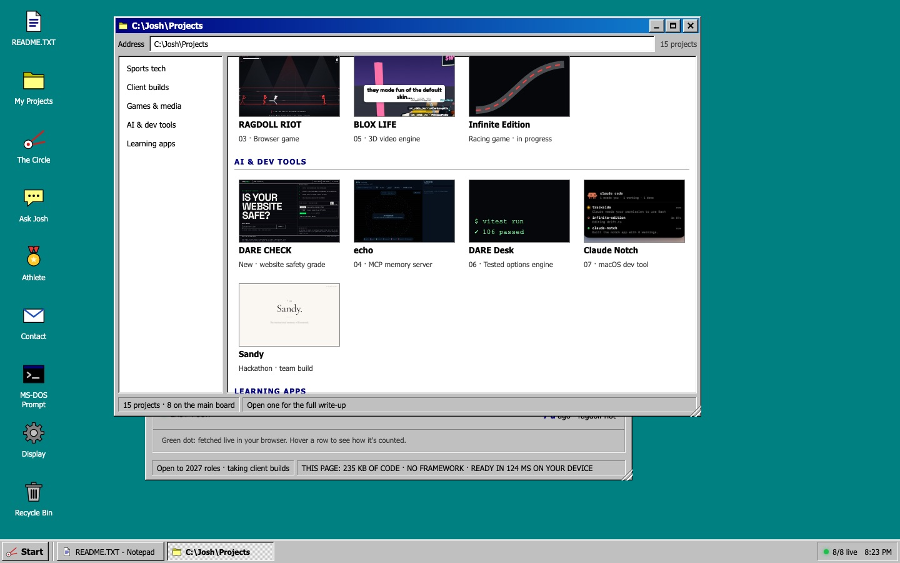
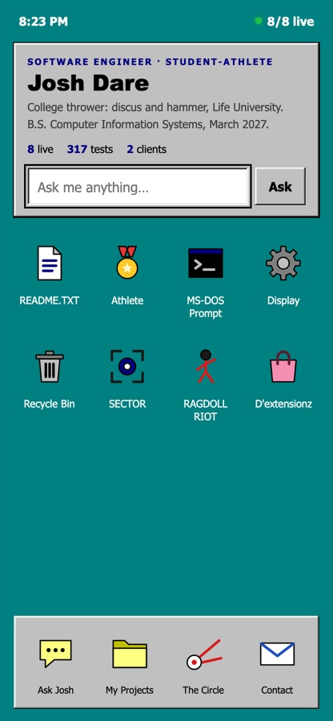
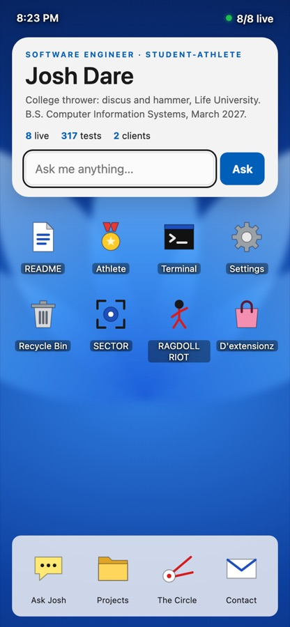
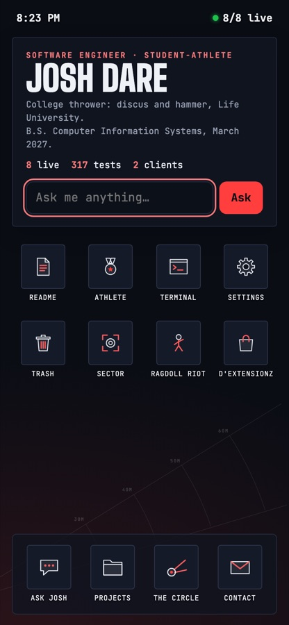
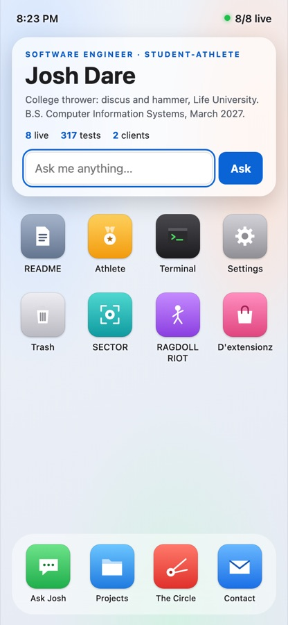
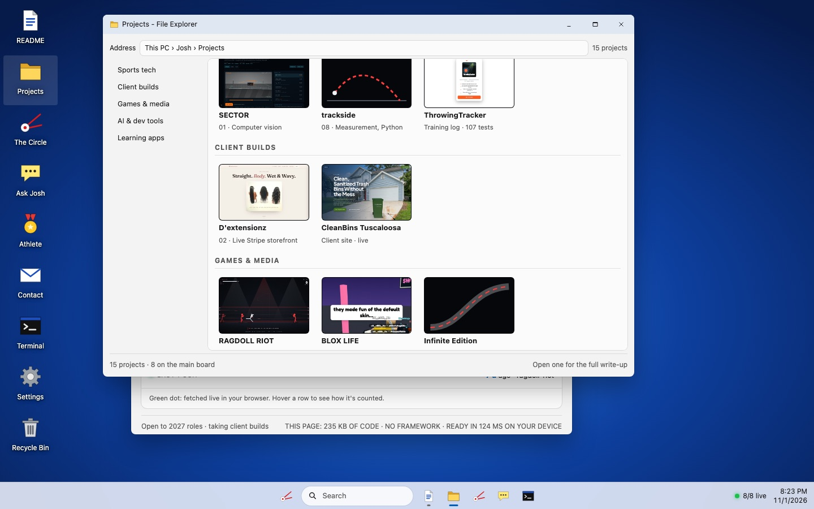
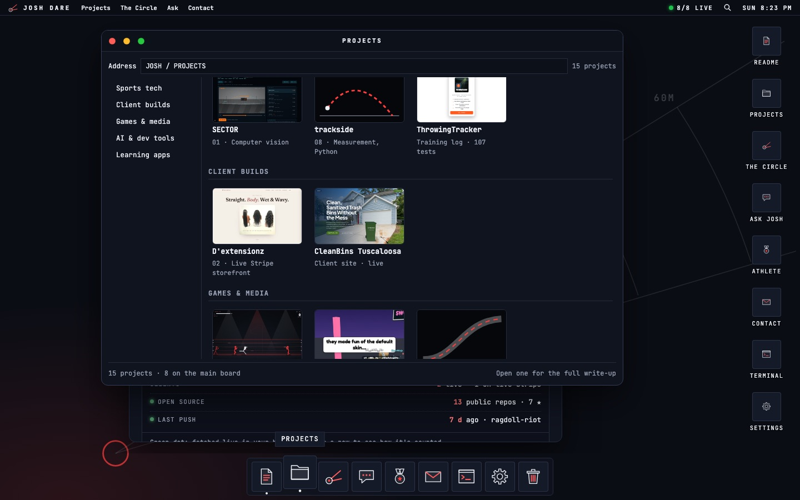
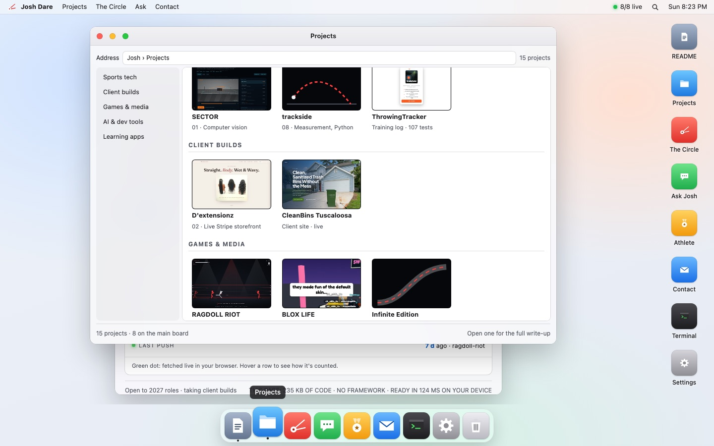

  

<h1 align="center">DARE-OS</h1>

  The portfolio of <b>Joshua Dare</b>: software engineer and college thrower (discus, hammer). 
  A night stadium you can throw in, then a desktop you can actually use.

  <a href="https://dare-os.vercel.app"><b>dare-os.vercel.app</b></a>

  

## What's inside

- **THE CIRCLE.** The landing page is a three.js night stadium seen from behind the throwing circle. Take a throw (or hold on the field to spin): the discus flies with the same physics the tests pin, lands beside a project's flag, and a red laser measures it back to the rim. The jumbotron reads out that project's number, how it was measured and when. Every flag is also on a keyboard-friendly ribbon.
- **Shipped this week.** Public GitHub activity for Waleee7, read live from the GitHub API, with timestamps.
- **Clean look.** A plain, printable one-page résumé at `?view=clean`, with no 3D.
- **Four themes.** Stadium Night (default: dark glass over the stadium), Retro 98, Windows 11 and Mac Light, each with its own window chrome, Start menu and icon names. Shareable with `?theme=`.
- **16 projects** in a file explorer, grouped into sports tech, client builds, games and media, AI and dev tools, and learning apps. Each one opens a full write-up.
- **Ask Josh.** A chat that answers questions about my work from a fact file, with no AI model and no API calls. It follows up on the last project you asked about and says so when something isn't in the file.
- **DISCUS DISASTER**, the 3D discus game, runs in its own window.
- **MS-DOS Prompt / Terminal**, a Recycle Bin, live status checks on every shipped project, and deep links to any window.
- **Phone layout.** A home screen with a dock, built for one-handed use.

  
  
  
  

## Featured work

| Project | What it is |
|---|---|
| **SECTOR** | Measures a throw (release speed, angle, height) from a single phone video |
| **ThrowingTracker** | Training log and analytics for throwers, offline-first |
| **GlobalLingo** | Translation app with a Three.js globe (click a country to pick its language) and haptics on mobile |
| **echo** | MCP memory server with a 3D brain view (React Three Fiber) |
| **RAGDOLL RIOT** | Browser brawler with ragdoll physics, three locations and an endless mode |
| **BLOX LIFE** | 3D video engine (Three.js, Web Audio, FFmpeg) that renders short skits |
| **Infinite Edition** | Arcade racing game with drift physics in Three.js (private, in progress) |
| **PEACH DASH** | 3D endless runner through Atlanta, in the browser |
| **TELLS** | In-browser scam checker that marks the exact words that give a message away |
| **Hushprint** | Shows what your files leak (GPS, author names) and strips it in the browser |
| **Claude Notch** | Native macOS app that puts coding sessions in the notch |
| **DARE CHECK** | Free website safety grade |
| **GROUND STOP** | Real-life travel sim on the live FAA status feed (in progress, no public link yet) |
| **Client sites** | D'extensionz (live store) and CleanBins Tuscaloosa |

## Built with

Plain HTML, CSS and JavaScript. No framework and no build step. three.js (r185, vendored, MIT) loads only on the stadium, after the page is up; phones get a lighter tier with a capped pixel ratio.

Tested with Node and Playwright: 186 chat checks and 86 page checks (the stadium, the throw, the laser, the clean look, layout, themes, keyboard, phone, reduced motion, no-JS fallback, zero console errors). Every project number on the site was re-run on 15 Nov 2026.

## Contact

[LinkedIn](https://www.linkedin.com/in/akinwaledare) · [GitHub](https://github.com/Waleee7) · jdare354@gmail.com

More screenshots

 

